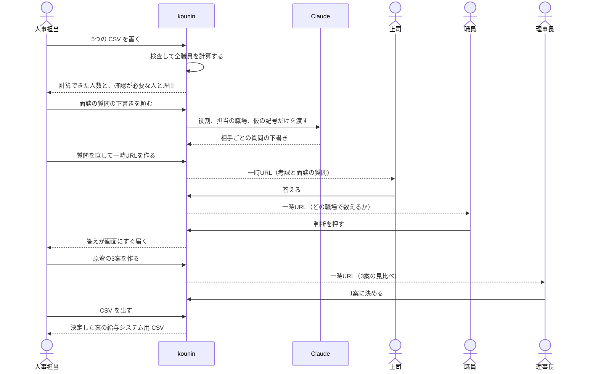
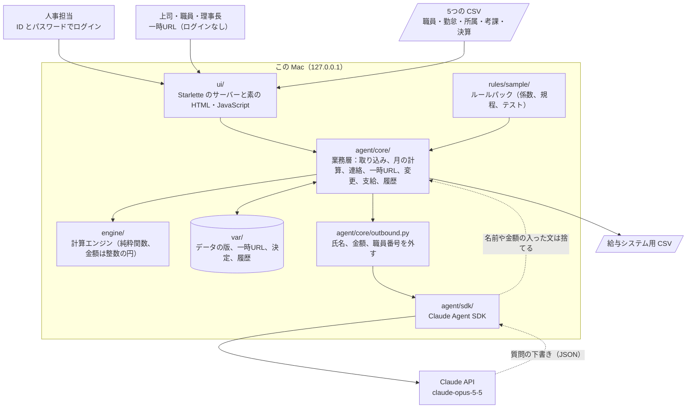

# kounin（後任）

**人事のあの人が明日来なくても、賞与と昇給の計算は続く。**

普段は kounin が毎月計算します。足りない時だけ、kounin から連絡が来ます。人は渡す、答える、決めるだけです。

Built with Claude: Japan 2026 の提出作品です。**今は MVP で、Claude は面談の質問の下書きだけにつないでいます。**

## 使う人の流れ

ログインするのは人事担当だけです。上司、職員、理事長には一時URLで聞きます。



## システムの構成

この Mac の中だけで動きます。金額はすべて `engine/` が計算し、Claude には計算させません。



## 試し方

```
uv sync
make app        # http://127.0.0.1:8020/ を開く
make reset      # 架空環境を最初の状態へ戻す
make demo       # 確認まで終えた架空環境を http://127.0.0.1:8030/ で開く（make app の状態には触らない）
```

ログイン ID は `amamiya`、パスワードは `kounin-2026` です。架空環境の見本で、手元環境では別のものにします。

職員は全員架空の550人です。基本給表、等級ポイント、職種係数、ランク係数、役職ポイントは実物で、支給月数と原資の値は架空です。ログインできるのは人事担当だけです。ほかの人はログインせず、人事担当が作る一時URLで答えます。127.0.0.1 だけで待ち受けるので、一時URLは同じ Mac の別の窓で開いてください。

**デモで置く CSV**

`make demo-csv` で `var/demo-csv/` に使う順で並びます。中身は全部架空です。

| フォルダー | 使う時 | 起きること |
| --- | --- | --- |
| `1_誤りあり` | 最初に5つを置く（省いてよい） | 1行も取り込まれず、所属の誤りの理由が日本語で出る |
| `2_正しいデータ` | 5つを置く。1 の後なら `所属.csv` だけでよい | 5つに確認が付き、計算できる |
| `3_確認で置く` | 確認の画面で `所属.csv` を置く | 3人の確認が済む |

**一巡の順**

| 順 | 誰が | すること | 起きること |
| --- | --- | --- | --- |
| 1 | 雨宮 文（人事担当） | 今月で `2_正しいデータ` の5つの CSV を置き、今月分を計算する | 5つが検査され、537人の計算が終わり、13人は確認が必要と出る |
| 2 | 雨宮 文 | 確認で `data/sample/fixes/所属-誤りの見本.csv` を置く | 1行も取り込まれず、理由が日本語で出る |
| 3 | 雨宮 文 | 確認で `3_確認で置く` の `所属.csv` を置いて確定 | 3人の確認が済む |
| 4 | 雨宮 文 | 確認で kounin が書いた面談の質問を見て、要らないものを消し、足りないものを足して URL を作る | Claude が相手ごとに質問を下書きする。人ごとに一時URLができる |
| 5 | 鳥海 樹、涼風 奏（上司） | 一時URLを開いて考課と面談の質問に答える | 自分宛ての質問だけが見え、答えが人事に届く |
| 6 | 千歳 澄（職員） | 一時URLを開いて、どの職場で数えるかを押す | 確認が必要な人が0人になる |
| 7 | 雨宮 文 | 支給で3案を作り、理事長のURLを作る | 全職員を3案で計算し、550人の点が案ごとに支給額の帯を動く |
| 8 | 楠見 悠（理事長） | 一時URLを開いて案を見比べ、1案に決める | 人事の画面に決定が届き、人事担当が CSV を出せるようになる |
| 9 | 雨宮 文 | CSV を出す | 決定した案の金額だけが出る |
| 10 | 雨宮 文 | 変更で「等級3のBのポイントを200にする」、差を見て承認 | 新しい版になり、決定が失効して CSV を出せなくなる |

人事の画面は開いたままで動きます。一時URLで答えが届くと、数と全職員の点がその場で変わります。

一時URLは72時間で切れ、全部に答えると閉じます。作り直すと前の URL は使えません。持っている人なら誰でも答えられるので、本人確認にはなりません。

「kounin に聞く」では、賞与の計算の手順、確認が必要な理由、ルールの中身を聞けます。教わっていないことは「まだ教わっていません」と答えます。

## 公開 URL について

**公開 URL は置いていません。** 次の理由で、Vercel や Cloudflare Workers にはそのまま載りません。

- 承認、決定、履歴を `var/` のファイルに書き続け、一時URLの答えを常駐のサーバーで画面へすぐ返します。サーバーレスの関数では状態が残りません。
- Claude Agent SDK は Claude Code の CLI を子プロセスで起動します。Workers では動きません。
- ログイン ID とパスワードをこの README で公開しているので、公開 URL に置くと、誰でも置いた人の API キーで Claude を呼べます。

載せるなら、コンテナ（Cloudflare Containers など）と永続ボリュームを使い、Claude を呼ばない読み取り専用の見本に絞る形になります。手元では `make demo` で同じ画面を開けます。

## 読む順

| 順 | 文書 | 分かること |
| --- | --- | --- |
| 1 | [SPEC.md](SPEC.md) | 何を作るか、受け入れ条件、公開の範囲 |
| 2 | [CLAUDE.md](CLAUDE.md) | 作業で守ること |

## 検証

`make test` と `make check-public` で確かめます。
